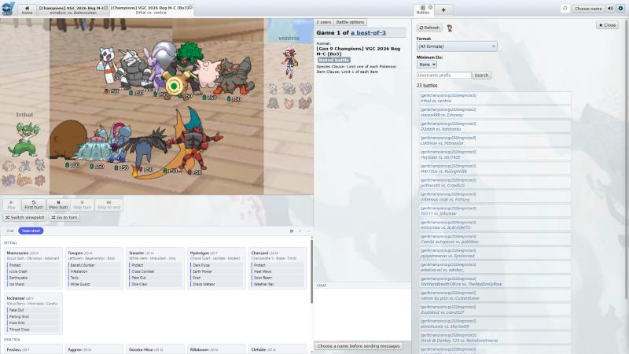
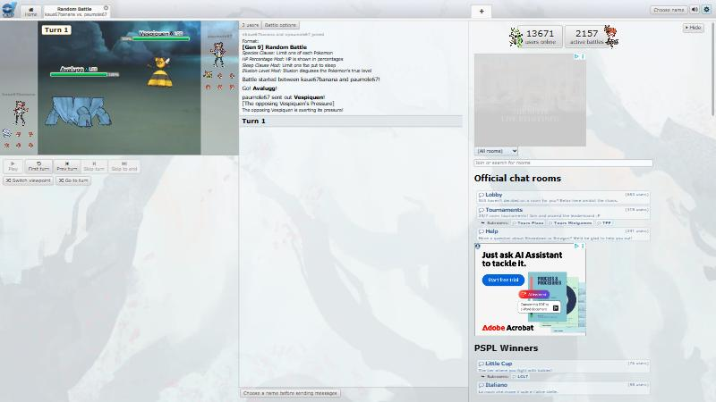
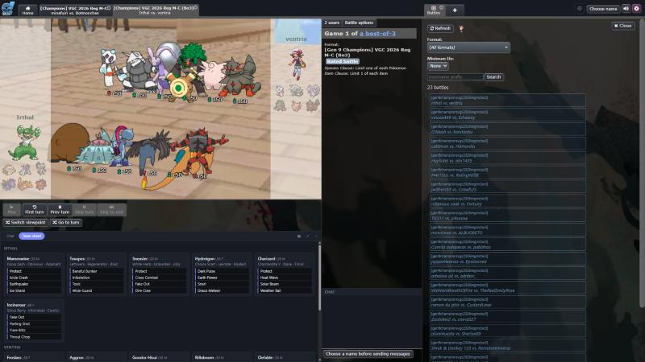
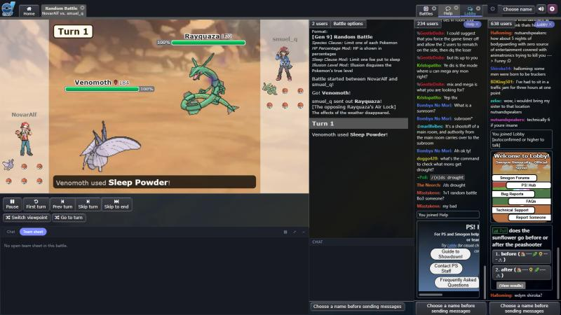
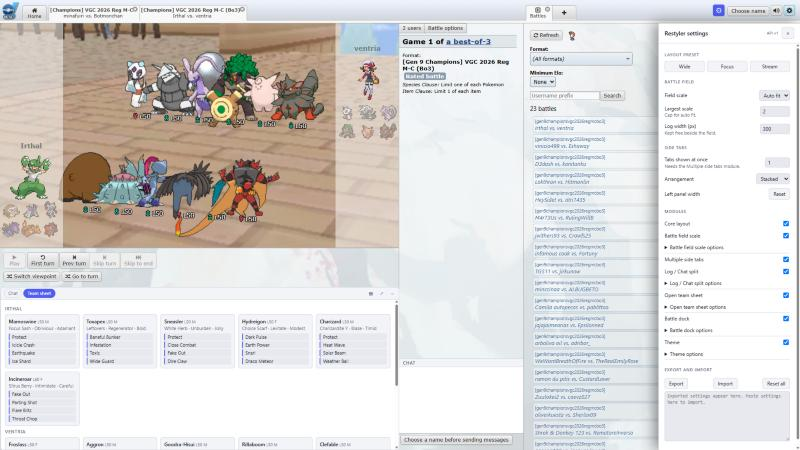

# Showdown Restyler

[](https://github.com/definitelybenny/showdown-restyler/actions/workflows/ci.yml)
[](https://github.com/definitelybenny/showdown-restyler/releases/latest)
[](LICENSE)
[](https://github.com/definitelybenny/showdown-restyler/commits/main)
[](https://www.tampermonkey.net/)

A Tampermonkey userscript that restyles and rearranges the **new (Preact) Pokémon Showdown client**: a bigger battle field, resizable panes, team sheet and chat in their own panels, several side tabs at once, and a modern theme. Built from small modules you can switch on and off.



## Before and after

| Stock client, 1920x1080 | With Restyler |
|---|---|
|  |  |

## Features

| Module | What it does |
|---|---|
| Core layout | Draggable gutter between the battle and the side panel, saved between visits. Double-click it to reset. Presets: Wide, Focus, Stream. |
| Battle field scale | The field is no longer capped at 640x360. It scales up to fit (up to a limit you set), with an option for sharper or smoother sprites. |
| Multiple side tabs | Drag a side tab onto the side area to place it, like splitting a browser window. Drop zones show where it will land. Pinned tabs are underlined, and a chip on each slot unpins it. Home never takes a slot unless you ask. |
| Log / Chat split | Chat lines move out of the battle log into their own strip. |
| Open team sheet | Open team sheets as cards in a panel, instead of a folded section in the log. |
| Battle dock | The empty space under the battle controls hosts panels (team sheet, chat). Pop a panel out into a side tab or its own window. |
| Theme | Light, dark or auto, an accent colour and a background, driven through the client's own theme so other scripts follow. |
| Settings drawer | Gear at the top right. Every module option, plus JSON export and import. |





## Install

1. Install [Tampermonkey](https://www.tampermonkey.net/) (or another userscript manager).
2. Open the [latest release](https://github.com/definitelybenny/showdown-restyler/releases/latest) and click `showdown-restyler.user.js`. Tampermonkey asks to install it, and updates itself from the same place.
3. Go to the new client at <https://play.pokemonshowdown.com/preactalpha>.

On the classic client the script logs one line to the console and does nothing.

## Using it

- Click the gear (top right) for settings.
- Drag the thin bar between the battle and the side panel to resize. Double-click it to reset.
- Drag a side tab (Showdex, Mock Regional, a chat room) onto the side area and drop it on a zone to show it next to the current tab. Drag it again to reorder, or click the chip on its slot to unpin.
- Turn off any module in the drawer and the client goes back to stock behaviour for that part.
- Other scripts can add panels through `window.ShowdownRestyler`:

```js
ShowdownRestyler.registerPanel({ id: 'my-panel', title: 'Mine', render(el) { el.textContent = 'hi'; } });
ShowdownRestyler.on('battle:line', ({ room, args }) => { /* args is the parsed protocol line */ });
```

## Compatibility

- Tested against the client at [`smogon/pokemon-showdown-client@f49fca9`](https://github.com/smogon/pokemon-showdown-client/tree/f49fca99f83d7b61495c45274092de0dfe7de071). The new client changes often, so something may break after an update. Please open an issue.
- Designed to coexist with [Showdex](https://github.com/doshidak/showdex): the script wraps client functions instead of replacing them, and never registers a `battle` room type. **Not yet tested live with Showdex installed.**
- Pairs with [Mock Regional Helper](https://github.com/definitelybenny/mock-regional-helper), which can register as a panel through the API.

## Development

```bash
npm install
npm run watch   # rebuilds dist/showdown-restyler.user.js
npm test
```

See [CONTRIBUTING.md](CONTRIBUTING.md). The research and design behind this are in [RESEARCH.md](RESEARCH.md) and [docs/](docs/).

## License

[MIT](LICENSE). Not affiliated with Smogon or Pokémon Showdown.
